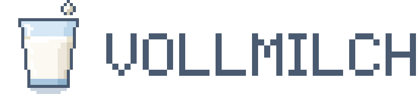
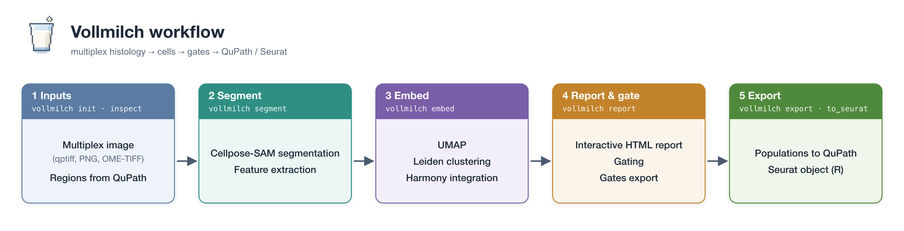

<p align="center"></p>

# Vollmilch

Segmentation, per-cell features and interactive gating for multiplex histology, with a round trip to QuPath.



The report is a single HTML file with no server and no internet connection needed, so it can be emailed or put on a shared drive. Gates are kept in the browser and saved as a small JSON file that anyone can load into the same report or apply with `vollmilch export`.

**Status: beta.** Please report problems and suggestions as [GitHub issues](https://github.com/lennardostendorf/vollmilch/issues).

## Install

Use **Python 3.11 or 3.12**. Newer Python versions often lack prebuilt packages for parts of the stack (h5py, torch, scikit-image), so pip tries to compile them and fails. Install into a fresh environment, e.g. with conda/mamba:

```bash
mamba create -n vollmilch python=3.12 -y && mamba activate vollmilch
pip install "vollmilch[all] @ git+https://github.com/lennardostendorf/vollmilch"
vollmilch --version
```

or as a standalone command with [uv](https://docs.astral.sh/uv/): `uv tool install --python 3.12 "vollmilch[all] @ git+https://github.com/lennardostendorf/vollmilch"`.

## Quick start

Make a project folder with your images in a `data` subfolder, and run every command from the project folder:

```
my_project/
  data/            images, plus QuPath region outlines and an optional samples.csv
  config.yaml      settings, written by vollmilch init and then edited
  vollmilch_out/   all results, created by vollmilch
```

`vollmilch init` writes `config.yaml`, a commented settings file that already points to `data/`. Open it and set at least the image (`source.path`), the nuclear channel (`segmentation.nuclear_channel`) and the regions to analyse (`regions`: QuPath outlines, a mask, or whole images). Relative paths in it count from the config file. `vollmilch inspect` then checks that the images, channels and regions are found, before anything long runs.

```bash
cd my_project
vollmilch init --type qptiff -o config.yaml     # or --type ome_tiff / png_folder; then edit config.yaml
vollmilch inspect config.yaml                   # channels, pixel size, samples; checks channel names
vollmilch segment config.yaml                   # resumable; --samples A,B  --force  --reuse-segmentation
vollmilch cofactors config.yaml                 # optional: tune asinh cofactors -> vollmilch_out/cofactors/cofactors.html
vollmilch embed config.yaml
vollmilch report config.yaml                    # -> vollmilch_out/report.html
# gate in the browser, click "Save gates"
vollmilch export config.yaml report_gates.json  # -> vollmilch_out/export/report_gates/
```

`vollmilch run config.yaml` does segment + embed + report in one go. `vollmilch to_seurat config.yaml` exports the cells to Seurat (see below).

To try it without your own data, on a synthetic slide with two biopsies (the report ends up in `demo_out/report.html`):

```bash
git clone https://github.com/lennardostendorf/vollmilch && cd vollmilch
python tests/make_synthetic.py data && vollmilch run examples/demo_synthetic.yaml
```

## Inputs

| `source.type` | what | channel names | pixel size |
|---|---|---|---|
| `qptiff` | Akoya / PerkinElmer `.qptiff` | `<Biomarker>` / `<Name>` of each page | TIFF resolution tags |
| `png_folder` | one image per channel (`.png`, also `.tif`); one folder = one image, or a folder of such folders | file name (`channel_name_regex` strips prefixes like `01_`) | **`pixel_size_um` required** |
| `ome_tiff` | one `.ome.tif` or a folder of them | OME `Channel Name` | OME `PhysicalSizeX` |

Large files are read lazily, one channel and one region at a time.

For PNG sources, vollmilch writes `vollmilch_out/images/<image>.ome.tif` (all channels, named, with pixel size). Open that in QuPath so the exported cells line up.

**Regions** (each region becomes a sample):
- `geojson`: QuPath annotations (select them, *File ▸ Export objects as GeoJSON*). The sample name is the annotation name, falling back to its class. With several images, put `{image}` in the path.
- `label_image`: a mask image of the same size; every non-zero label is a region.
- `none`: whole images.

Cells are kept if their centroid lies inside the region. Pixels outside the region are blanked before segmentation, so neighbouring biopsies don't leak in.

`samples_table` (CSV with a `sample` column plus e.g. `patient`, `condition`, `run`) adds colour-by options and the Harmony batch key.

## Segmentation

| `segmentation.mode` | objects | compartments |
|---|---|---|
| `nuclei` | Cellpose-SAM on the nuclear channel | nucleus |
| `expand` | nuclei + a ring of `expand_um` (like QuPath cell expansion) | nucleus, cell, cytoplasm |
| `cells` | nuclei **and** whole cells (Cellpose-SAM on `cyto_channels` + nuclear channel), matched by overlap. Unmatched nuclei become expanded cells (`keep_unmatched_nuclei`). | nucleus, cell, cytoplasm |

Regions are normalised once (percentiles over the whole region) and segmented in `tile_px` windows with `overlap_px` overlap. Each object comes from the window whose core contains its centroid, so no object is cut at a seam. `overlap_px` must be larger than the biggest cell diameter in pixels. Check `vollmilch_out/qc/<sample>_segmentation.png` (nuclei cyan, cells magenta).

## Features (`samples/<sample>/cells.parquet`)

- `<marker>:<compartment>:<stat>`: raw intensity (stats `mean`, the default, `median`, `max`, `p90`, `sd`) in `nucleus`, `cell`, `cytoplasm`. The median ignores bright specks and signal spilling in from neighbours (set it in `features.stats`, `embedding.stat`, `report.stats`). In background-subtracted images (most pixels exactly 0, e.g. MELC), though, a cell's median is 0 unless more than half of its pixels are stained, which loses membrane markers and small stained areas: keep `mean` there.
- `nucleus:*`: area, perimeter, circularity, eccentricity, solidity, axes, aspect ratio; DAPI integrated intensity, CV, gradient, local SD, bright-chromatin fraction
- `cell:*`: the same shape features, plus nucleus/cell area ratio
- `x_px, y_px` (image pixels) and `x_um, y_um`

Tables are Parquet (`arrow::read_parquet()` in R). The viewer and the embedding use `asinh(value / cofactor)`, with per-marker cofactors in `transform.cofactors`.

## Cofactors

`vollmilch cofactors config.yaml` suggests an asinh cofactor for every marker and writes `vollmilch_out/cofactors/cofactors.html`: one ridge plot per marker (one ridge per sample) with a slider to try other cofactors. *Download cofactors.csv* saves the chosen values; put the file next to the config and point to it:

```yaml
transform:
  cofactor: 5                 # markers not in the file
  cofactors: cofactors.csv    # columns marker,cofactor (others ignored); or a mapping {CD3: 20}
```

The suggestion puts the cofactor at the upper edge of the negative cells. Negatives then stay near-linear and compressed around 0, and signal above them is log-scaled. It is computed per sample (▲ on each ridge); the marker suggestion is the median over samples. How the upper edge is found depends on the data:

- **Measurable background** (raw or offset intensities): background mode + 3 × background SD, measured on the low side of the histogram peak, where positive cells don't reach. On simulated data this gives the usual values: about 5 for CyTOF-like counts, 1–5 for IMC-like counts, and just above the offset for raw fluorescence. Saturated pixels are ignored. If the tallest peak is not background (a marker on most cells), the viewer warns.
- **Background subtracted** (background set to exactly 0, as in the standard MELC preprocessing): recognised by a pile-up of exact zeros. That means most pixels, or cells whose every pixel is 0, which noise never produces. The negative cells are then the zero cells plus cells with a few stray positive pixels, and on a log scale the stray-signal cells and the positive cells form two humps. The suggestion is the split between them: the Otsu threshold of log10 of the non-zero cell means. If the two humps are not clearly separated (between-class share of the variance below 0.66; a single hump gives 0.64), the viewer says to judge by eye. That happens with a marker on most cells, or too few positive cells. When most markers are background-subtracted, markers without any zero cells (e.g. DAPI) are flagged as probably on every cell. Pixels can't show the split, because a cell mean mixes zeros and signal, so these markers get a suggestion only from cells.

- `--from auto` (default) uses the cells once every sample is segmented, otherwise pixels.
- `--from pixels` samples up to `--max-pixels` pixels per sample in random windows inside the regions, so it works before segmentation. Pixels are noisier than cell means, so these suggestions err on the high side.
- `--from cells` uses the segmented cells' intensities (`embedding.compartment`/`stat`), the values that are actually transformed.
- `suggested.csv` (a valid cofactor file, plus the method per marker) and `per_sample.csv` (suggestion, method, background and SD or split separation, share of zeros per sample and marker) are written alongside.

New cofactors need `vollmilch embed` and `vollmilch report`, not a new segmentation. Choose them before gating: gates are drawn in asinh units and do not follow a changed cofactor. `vollmilch inspect` warns about cofactor markers that are not channel names.

## Embedding

`vollmilch embed` z-scores the chosen markers (optionally plus morphology), runs PCA, then neighbours → UMAP → Leiden twice: on the PCA and on the Harmony-corrected PCA (`embedding.batch_key`: `sample` or any `samples_table` column). Above `max_cells`, UMAP runs on a random subset and Leiden labels are transferred to all cells by kNN.

Re-embed a gated population (e.g. only immune cells, with immune markers):

```bash
vollmilch embed config.yaml --gates gates.json --population Immune --markers CD3,CD4,CD8,CD20,CD68 --report
```

Every embedding appears in the viewer's UMAP menu ("Immune · Harmony", …) and as `leiden <name>` colour/heatmap options.

## Viewer

- **Plot** any two features (markers, morphology, UMAPs, position), with optional log axes. Colour by sample, metadata, Leiden, population or any feature. Dot size follows the number of plotted cells (*auto*) or is set by hand, 0.5–16 px. *Spatial* shows x/y in µm in QuPath orientation.
- **Gates**: rectangle (edges dragged onto the plot border are open-ended) or polygon. A new gate is a child of the population being shown. Click a population to show it and gate further inside it (hierarchy, breadcrumb navigation). Gates on UMAP axes only include cells that are part of that embedding.
- **Cell panel**: hovering over a dot shows that cell's thumbnail, population, the plotted values and the thumbnail-channel intensities in the right panel. *Snap to cells with thumbnails* (on by default) picks the nearest cell that has a stored thumbnail. Hovering a gallery tile does the same.
- **Cells**: click a point, drag a box, or take random cells of the shown population. The thumbnails show any number of channels, each with its own colour and black/white points, plus nucleus and cell outlines of the centred object.
- **Tables**: counts and % of parent / % of all per sample (CSV), and mean expression per population or Leiden cluster.
- **Save gates** downloads the JSON. Gates also persist in the browser's storage for that report. *Load gates* applies a JSON from a colleague. `vollmilch report --gates g.json` builds a report that opens with those gates.

Each sample is capped at `report.max_cells_per_sample` cells (random subset, cells with thumbnails first). The viewer's percentages are then estimates; `vollmilch export` always uses every cell.

## Back to QuPath

`vollmilch export config.yaml gates.json` writes, per gates file:
- `<image>_cells.geojson`: one QuPath *cell* per object (cell outline + `nucleusGeometry`; *detections* in nuclei mode). Each has its name (= `cell_id`), a classification (deepest population, in the gate colour), raw marker measurements and `Gate: <name>` 0/1 columns. Drag it onto the image in QuPath (or *File ▸ Import objects*). Options: `--only <population>`, `--measurements none|markers|all`, `--full-path` (class `Parent: Child`, i.e. QuPath derived classes).
- `classes.csv` (cell_id, population, path, x/y px, gate flags) and `population_counts.csv` (per sample: count, parent count, % parent, % total).

Population assignment in the export uses the same arithmetic as the viewer. On the test data both agree cell by cell. To re-classify cells already in QuPath after changing gates, run `qupath/import_classes.groovy` with the new `classes.csv`.

## To Seurat

```bash
vollmilch to_seurat config.yaml --gates gates.json   # -> vollmilch_out/seurat/seurat.rds
```

writes a [Seurat](https://satijalab.org/seurat/) object if R with Seurat (v5) is installed, otherwise the files to build one (`Rscript make_seurat.R` in that folder, or `Read10X()` by hand):
- assay `Protein` (`--assay`): `counts` = raw per-cell intensities, `data` = `asinh(intensity / cofactor)` with vollmilch's cofactors. Values: `embedding.compartment` and `embedding.stat`, or `--compartment` / `--stat`.
- metadata: sample, samples_table columns, x/y in px and µm, morphology (`nucleus_area_um2`, …), Leiden clusters, and with `--gates` the deepest `population`, its `population_path` and one `gate_<name>` column per gate. Identities: populations, else the last Leiden clustering, else the sample.
- reductions: every UMAP (`umap_all`, `umap_all_harmony`, …; cells outside a subsampled embedding are `NA`) and `spatial` (x and −y in µm, so `DimPlot(obj, reduction = "spatial")` shows the tissue as in the image).

The matrix files are a 10x folder (`matrix.mtx.gz`, `features.tsv.gz`, `barcodes.tsv.gz`), plus `asinh.mtx.gz`, `metadata.csv.gz` and `reduction_*.csv.gz`. Zeros are not stored, so background-subtracted data stays small.

## Output layout

```
vollmilch_out/
  samples/<sample>/  cells.parquet  nuclei_labels.tif  cell_labels.tif  thumbs.npz  meta.json
  embeddings/<name>.parquet|json
  qc/<sample>_segmentation.png
  cofactors/  cofactors.html  suggested.csv  per_sample.csv
  images/<image>.ome.tif        (PNG sources)
  report.html
  export/<gates>/  <image>_cells.geojson  classes.csv  population_counts.csv
  seurat/  seurat.rds  make_seurat.R  matrix.mtx.gz  features.tsv.gz  barcodes.tsv.gz  asinh.mtx.gz  ...
  vollmilch.log
```

## License

MIT
